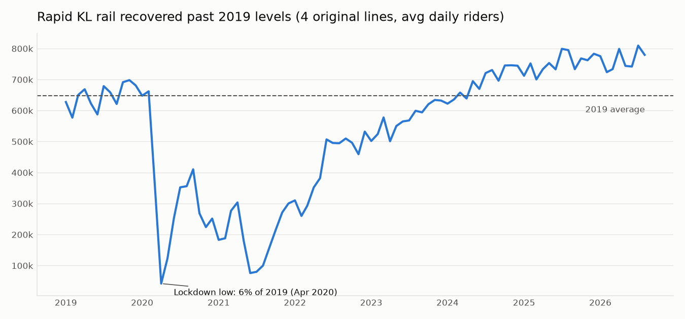
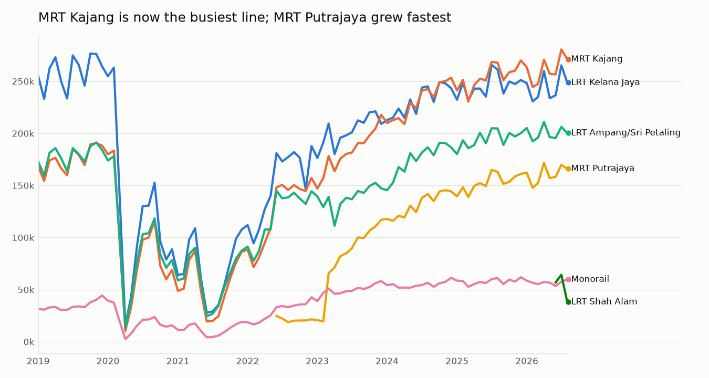
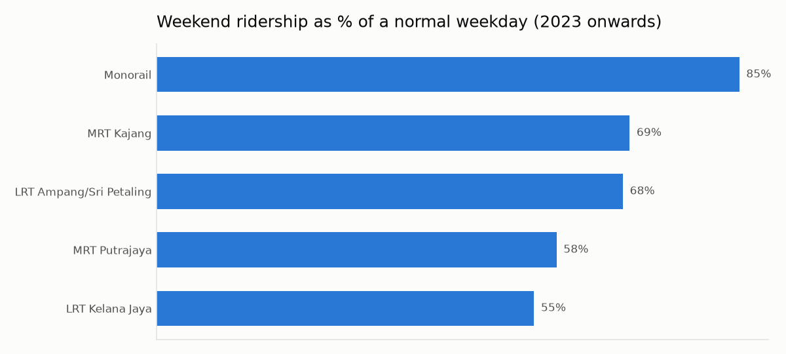
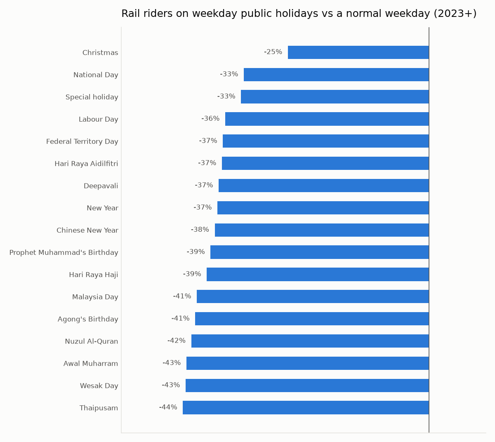

# Rapid KL Rail Ridership: Recovery, Commuting Patterns and Holidays

**Live app:** https://rapidkl-ridership-analysis.streamlit.app/

**Question:** Has Klang Valley rail ridership recovered from COVID, which lines carry the city, and how do weekends and public holidays change demand?



## Key findings (Jan 2019 to Aug 2026)
1. **Ridership is now above pre-COVID levels.** The 4 original lines averaged **752k riders/day in 2025, 116% of 2019** (647k). They first beat the 2019 average in **March 2024**, after falling to **6% of normal in April 2020** during the first lockdown.
2. **MRT Kajang overtook LRT Kelana Jaya as the busiest line.** In 2019 Kelana Jaya carried far more riders than Kajang (259k vs 175k a day), but by 2025 Kajang led (254k vs 246k).
3. **MRT Putrajaya reached 153k riders a day in 2025.** Ridership jumped after the full line opened in March 2023.
4. **LRT Kelana Jaya is the most commuter-driven line.** Its weekends carry only **55%** of weekday riders. The **Monorail keeps 85%**, consistent with tourist and shopping trips in Bukit Bintang.
5. **Weekday public holidays cut rail ridership by 25–44%.** Thaipusam, Wesak and Awal Muharram see the biggest falls; Christmas the smallest.
6. **The record day was New Year's Eve 2025, with 1.35M rail riders.**

| | |
|---|---|
|  |  |



## So what? (for an operator or planner)
- Weekend demand on Kelana Jaya and MRT Putrajaya is about half of weekday demand, so weekend headways can be stretched there with little impact. The Monorail needs near-weekday service on weekends.
- Holiday timetables can plan for a drop of roughly 40%.
- LRT Shah Alam (data from 29 June 2026) dropped from 64k riders a day in July to 38k in August. This is worth checking against fare promotions before it is read as a demand trend.

## Interactive app
```bash
pip install -r requirements.txt
streamlit run app.py
```
Filter by line and date range, and switch between daily, weekly and monthly views. The app also shows a day-of-week profile and a holiday-impact table.

## Data and method
- **Data:** [data.gov.my daily public transport ridership](https://data.gov.my/data-catalogue/ridership_headline) (Prasarana). Only Rapid KL rail is used; KTM services are excluded.
- **Cleaning:** zero values before a line opened are treated as "not running", not as zero riders.
- **Holidays:** the Kuala Lumpur public holiday calendar comes from the `holidays` library. Replacement days ("cuti") are grouped with the original holiday.
- **Holiday effect:** each weekday holiday is compared with the average of normal weekdays in the same month, from 2023 onwards (after recovery).
- **Self-checks** in `analysis.py`: no missing dates, totals equal the sum of the lines, ratios fall in sensible ranges.

| File | What it does |
|---|---|
| `analysis.py` | Load, clean, compute findings, draw the 4 charts |
| `app.py` | Streamlit dashboard (reuses `load()` from `analysis.py`) |

**Next ideas:** add daily rainfall (MET Malaysia) to measure the effect of rain, and forecast the next month by line.

To refresh with new data, re-download `ridership_headline.csv` into `data/` and rerun `python analysis.py`.
